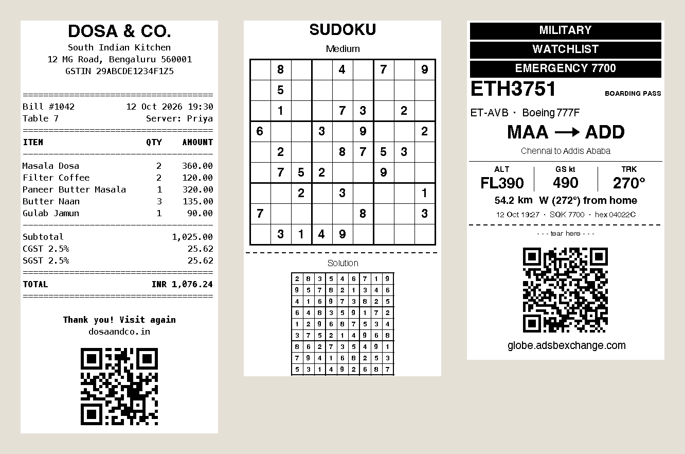
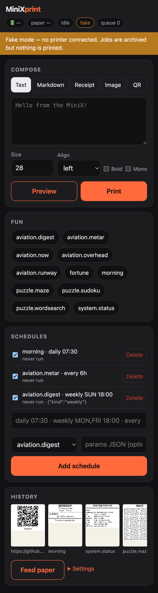
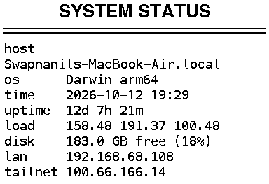
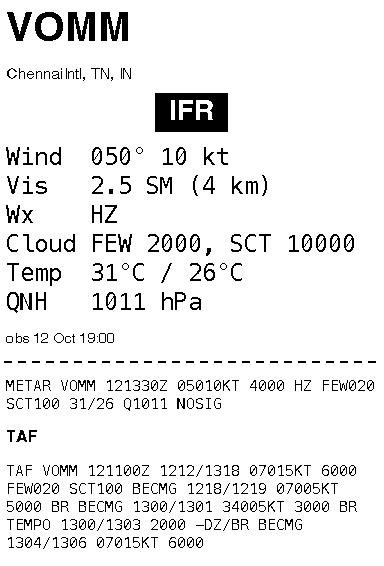
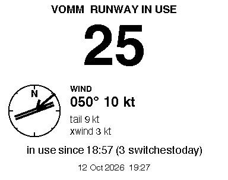
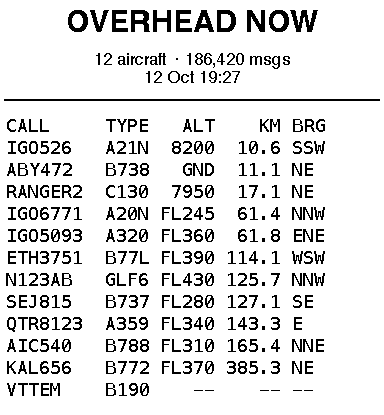
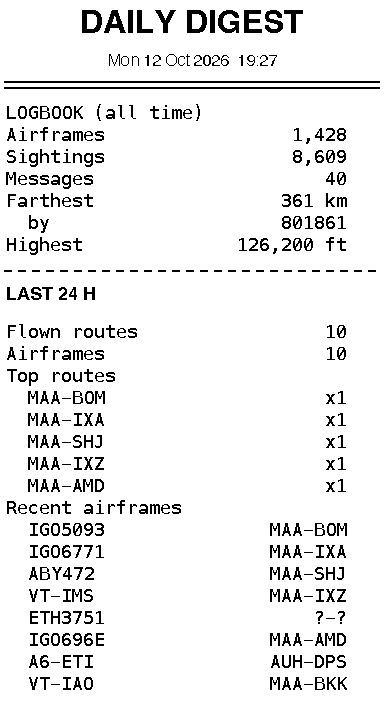

# minixprint

**A print server, CLI and rendering toolkit for the Seznik MiniX / LuckJingle S1 pocket thermal
printer — with a reverse-engineered protocol, a phone-friendly web dashboard, scheduled "jobs"
(puzzles, a morning docket, aviation cards from your ADS-B receiver) and a Raspberry Pi
deployment recipe.** Print text, Markdown, receipts, images and QR codes over USB or Bluetooth LE,
or point a cron-like scheduler at it and let it print your morning briefing.



## What it does

- **Speaks the printer's protocol** directly over USB serial or Bluetooth LE — no vendor app,
  no cloud. Every byte is documented in [PROTOCOL.md](PROTOCOL.md).
- **Renders anything to a 384-px 1-bit bitmap**: text, Markdown, receipts, dithered photos, QR codes
  and barcodes ([docs/RENDER.md](docs/RENDER.md)). Preview as PNG without a printer (`--out x.png`).
- **CLI** for scripts and pipes: `cal | minixprint pipe --mono` ([docs/CLI.md](docs/CLI.md)).
- **HTTP server** with a print queue, history, schedules and settings
  ([docs/API.md](docs/API.md)), plus a no-build **web dashboard** for your phone
  ([docs/DASHBOARD.md](docs/DASHBOARD.md)).
- **Jobs**: pluggable generators for things worth printing, run on demand or on a schedule
  ([docs/JOBS.md](docs/JOBS.md)).
- **Runs on a Raspberry Pi** behind Tailscale ([docs/DEPLOY.md](docs/DEPLOY.md)).

## Hardware

| Printer | Status |
|---|---|
| Seznik MiniX | Tested (USB + BLE) |
| LuckJingle S1 (`S1_LYiN48D_IND`) | Tested — same device under another name |
| LuckJingle D1 family | Expected to work (same chipset family), untested |
| Other LuckPrinter-SDK "Lujiang" printers (DP_D1, LuckP_D1, DP-L1S, …) | Untested — please [report](.github/ISSUE_TEMPLATE/printer-report.md) |

58 mm paper, 384 dots wide, 203 dpi.

## Quick start

```bash
git clone https://github.com/SwapnanilDhol/minixprint && cd minixprint
python3 -m venv .venv && . .venv/bin/activate
pip install -e .            # add ".[ble]" for Bluetooth LE
minixprint info             # name, MAC, firmware, serial, battery
minixprint text "hi"        # prints a line
minixprint serve            # http://127.0.0.1:8090/ — the dashboard
```

No printer handy? `minixprint serve --fake` archives jobs without printing, and
`minixprint text "hi" --out hi.png` writes the bitmap. Python 3.9+; on macOS, Bluetooth must be run
from an app that holds Bluetooth permission (Terminal.app is fine, see [PROTOCOL.md](PROTOCOL.md)).



## Raspberry Pi + Tailscale

1. Plug the printer into the Pi (USB) and `git clone` + `pip install -e .` in `~/minixprint`.
2. Install `deploy/minixprint.service` as a systemd unit (`minixprint serve --host 127.0.0.1`).
3. `tailscale serve --bg --set-path /print http://127.0.0.1:8090` — HTTPS, only your tailnet.
4. Open `https://<pi>.<tailnet>.ts.net/print/` on your phone and add it to the home screen.
5. Optional: an iOS Shortcut or a CUPS virtual printer to print from any app.

Full walkthrough in [docs/DEPLOY.md](docs/DEPLOY.md); see also [docs/PI.md](docs/PI.md) and
[deploy/tailscale.md](deploy/tailscale.md).

## Jobs

Run one with `curl -X POST localhost:8090/api/jobs/fortune/run` or from the dashboard's **Fun**
panel; schedule it with `daily 07:30`, `weekly MON,FRI 18:00` or `every 30m`.

| Job | What it prints | Sample |
|---|---|---|
| `morning` | Date, weather, your to-do file, notes and a fortune |  |
| `fortune` | One line of wisdom between rules |  |
| `system.status` | Host, uptime, load, disk, IP addresses |  |
| `puzzle.sudoku` | Unique-solution sudoku (easy/medium/hard) |  |
| `puzzle.maze` | Perfect maze with entrance and exit |  |
| `puzzle.wordsearch` | Word-search grid and word list |  |
| `aviation.overhead` | Boarding-pass card for aircraft overhead |  |
| `aviation.metar` | METAR/TAF strip for your airports |  |
| `aviation.runway` | Runway in use, wind rose, crosswind |  |
| `aviation.now` | Departure-board list of aircraft in range |  |
| `aviation.digest` | Daily/weekly traffic digest |  |

Adding your own is one file — see [CONTRIBUTING.md](CONTRIBUTING.md#add-a-job).

## Aviation integration

If you run an ADS-B receiver (RTL-SDR + `dump1090-fa`), the `aviation.*` jobs read its
`aircraft.json`, look up routes and weather from public sources and print a boarding-pass card
whenever something interesting flies over — military, watch-listed or squawking an emergency.
Works standalone or alongside a Telegram bot. Details: [docs/AVIATION.md](docs/AVIATION.md).

## Protocol

The printer is driven by a tiny command set. A complete print job is six steps
(full details, replies, BLE specifics and untested commands in [PROTOCOL.md](PROTOCOL.md)):

```
00 ×12                       wake
10 FF F1 03                  enable, Lujiang mode
10 FF 10 00 nn               density 0..2 (optional)
1D 76 30 00 30 00 hL hH      GS v 0 raster header: 384 px wide, h rows
<rows × 48 bytes>            1 bpp, MSB first, 1 = black
1B 4A nn                     feed nn dots
```

## Project layout

```
minixprint/protocol.py     byte constants and builders (single source of truth)
minixprint/transport/      USB serial + BLE transports
minixprint/printer.py      MiniX driver: connect(), print_image(), info(), status()
minixprint/render/         text, markdown, receipt, image, QR/barcode -> 384-px bitmaps
minixprint/jobs/           pluggable generators (JOBS dicts, auto-discovered)
minixprint/server/         FastAPI app, print queue, scheduler, SQLite store, static dashboard
minixprint/cli.py          the `minixprint` command
deploy/                    systemd unit, Tailscale and iOS Shortcut notes
docs/                      per-topic docs and sample bitmaps
scripts/                   regenerate samples/previews
tests/                     pytest suite (no printer or network needed)
```

Architecture overview: [docs/ARCHITECTURE.md](docs/ARCHITECTURE.md).

## Contributing

Issues and PRs welcome — especially **reports from other LuckJingle models**
(run `minixprint info` and open a [printer report](.github/ISSUE_TEMPLATE/printer-report.md)).
See [CONTRIBUTING.md](CONTRIBUTING.md) and the [changelog](CHANGELOG.md).

## License

[MIT](LICENSE).

## Credits

The protocol work stands on others' prior art:

- [rhutikcodes/seznik-printer-api](https://github.com/rhutikcodes/seznik-printer-api) — BLE command bytes
- [lsong.org/luckjingle-d1-printer](https://lsong.org/luckjingle-d1-printer) — web-bluetooth reference implementation
- [ChiaraCannolee/thermal-pocket-printer-basic](https://github.com/ChiaraCannolee/thermal-pocket-printer-basic) — decompiled LuckPrinter SDK notes
- [0xMH/fichero-printer](https://github.com/0xMH/fichero-printer) — AiYin sibling, Lujiang notes
- [luckjingle.com/faq](https://www.luckjingle.com/faq) — LED meanings

Not affiliated with Seznik or LuckJingle.
