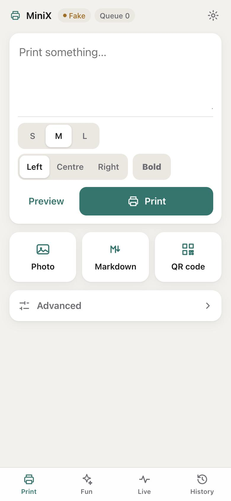
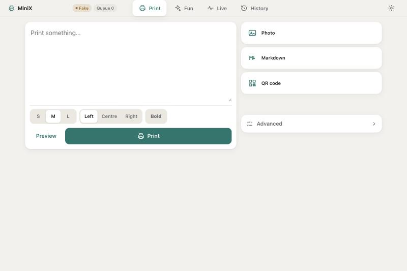
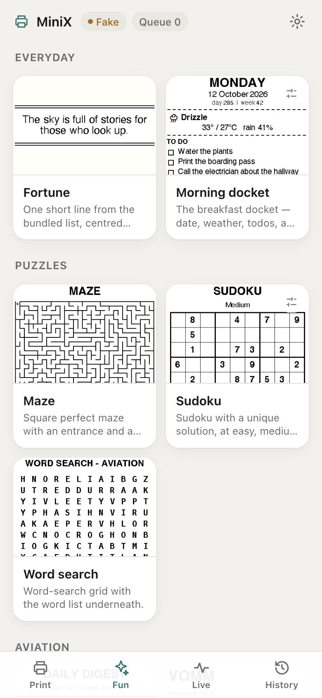
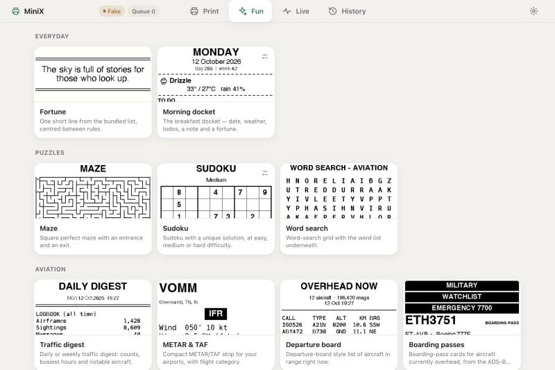
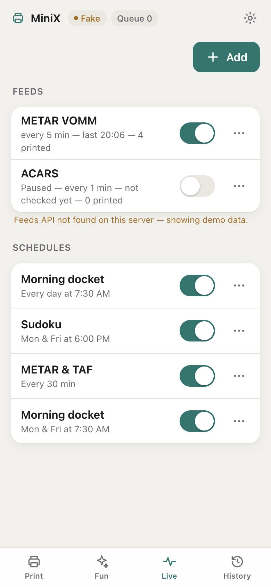
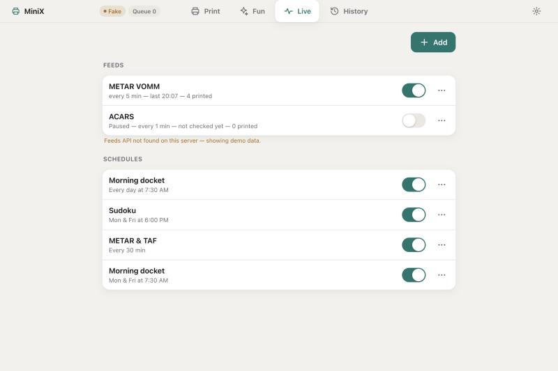
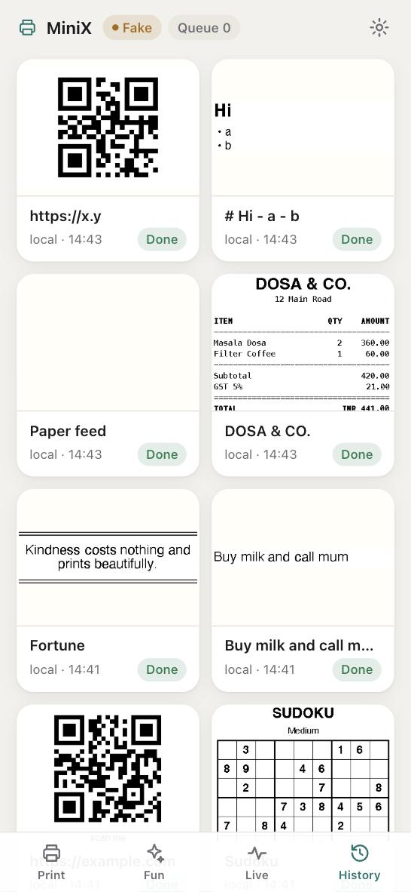
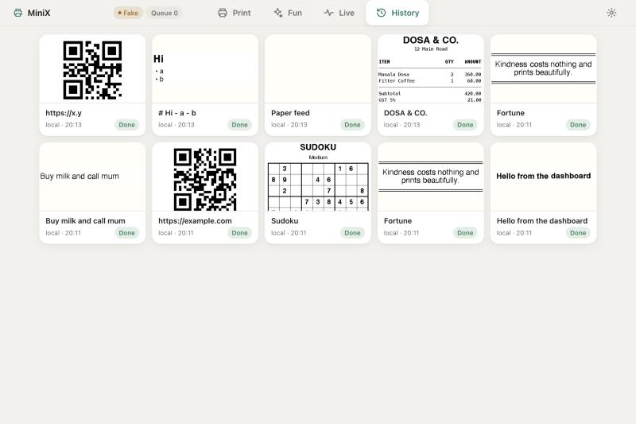
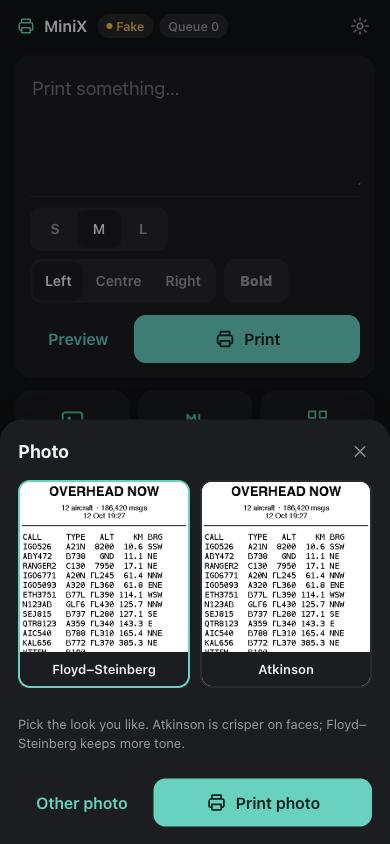

# Dashboard

Served at `/` by `minixprint serve`: plain `index.html` + `app.js` + `style.css` in
`minixprint/server/static/`, no build step, no framework, no CDN, relative URLs only (so it works at
`http://127.0.0.1:8090/` and under `https://swap-pi.<tailnet>.ts.net/print/`; keep the trailing slash).
Try it without a printer: `minixprint serve --fake`.

It is built for an iPhone over Tailscale: four bottom tabs on phones, top tabs from 900 px, 44-px touch
targets, safe-area insets, 16-px inputs (no iOS zoom), skeletons instead of layout shift, dark mode via
`prefers-color-scheme`, `prefers-reduced-motion` respected, everything keyboard-reachable (arrow keys move
between tabs and segmented controls). The URL hash (`#fun`, `#live`, …) selects the tab.

**Header (always visible, one line):** printer name, a Connected / Fake / Offline badge, battery with icon,
queue depth, and a gear that opens **Settings** (home airport, other airports, print darkness, timezone,
transport). Polled every 5 s while the tab is visible.

## Print

A text box and one big **Print** button. Size (S/M/L), alignment and Bold are small pills under it;
**Preview** shows the exact 384-px bitmap. Below: **Photo**, **Markdown** and **QR code** tiles.

- **Photo** opens the camera/library picker, then shows both dithers (Floyd–Steinberg and Atkinson) rendered
  by `/api/preview/image`; pick one and Print.
- **Markdown** and **QR code** are a single sheet each.
- **Advanced** (collapsed) holds print darkness (density), paper feed, and the receipt JSON editor with
  Preview/Print.

Every print shows a toast with the job id and a **View** link to its history PNG.

## Fun

One tile per `/api/jobs` entry, grouped (Everyday, Puzzles, Aviation, System), with a thumbnail and the job
description. **One tap prints**, after a one-second **Undo** toast (the request is only sent when it expires, so
Undo really cancels). Jobs that take parameters (Morning docket todos, Sudoku difficulty) open a small sheet
instead, with Preview and Print; there is no raw JSON anywhere.

Thumbnails are static files in `static/thumbs/<job>.png`, copied from `docs/samples/` by
`python scripts/make_thumbs.py` (run it after `make_*_samples.py`; a job without a sample shows a glyph).
Not rendered live because several jobs hit the network.

## Live

Feeds and schedules as lists of switches: "METAR VOMM — every 5 min — last 13:30 — 4 printed" with an on/off
switch (start/stop). **Add** opens a sheet: *Feed* (kind picker and parameters generated from
`/api/feeds/kinds`) or *Schedule* (job, then Daily / Weekly / Every… builders that compose the spec for you
and read it back in words, e.g. "Mon & Fri at 6:00 PM"). The `⋯` menu has *Check now*, *Preview latest* and
*Delete* for feeds, *Print now* and *Delete* for schedules. If the server has no `/api/feeds` yet, the tab
shows clearly-labelled demo data so the UI can still be exercised.

## History

A grid of the last 60 jobs with their archived bitmaps, a status chip (Done / Failed / Skipped / Queued) and who
printed it (the Tailscale user name) with the time in the configured timezone. Tap one for the full image, details
and **Print again**.

## Screenshots

Captured from `minixprint serve --fake` (390 px phone, 1200 px desktop).

| | Phone | Desktop |
|---|---|---|
| Print |  |  |
| Fun |  |  |
| Live |  |  |
| History |  |  |

The photo sheet (dark mode):

