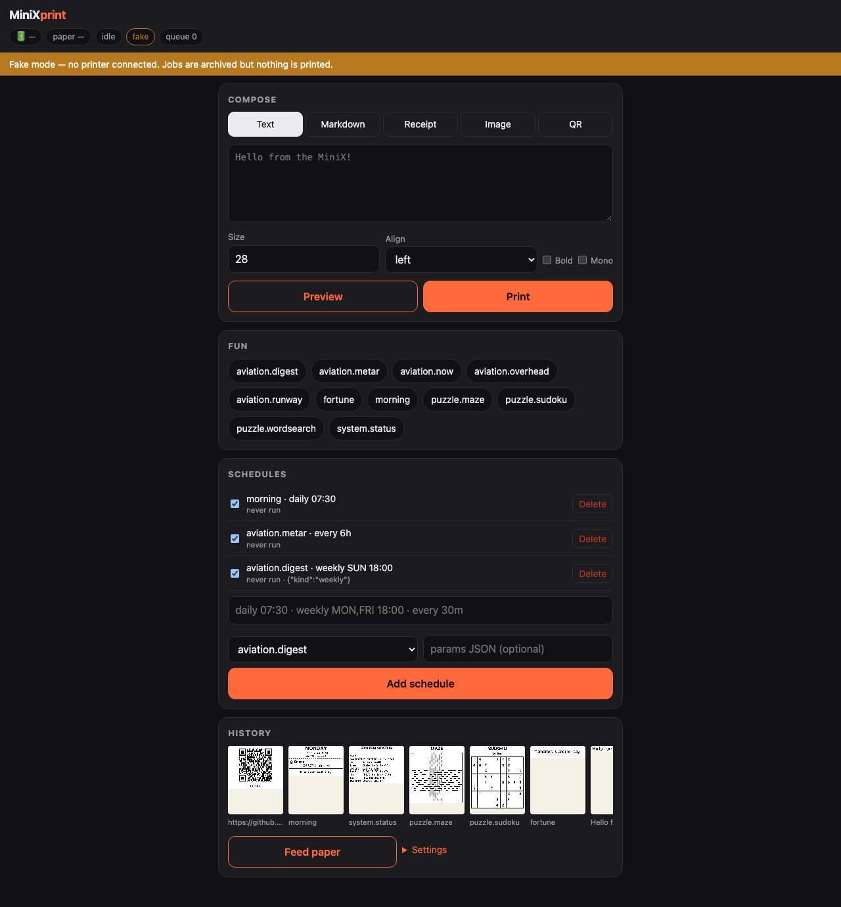
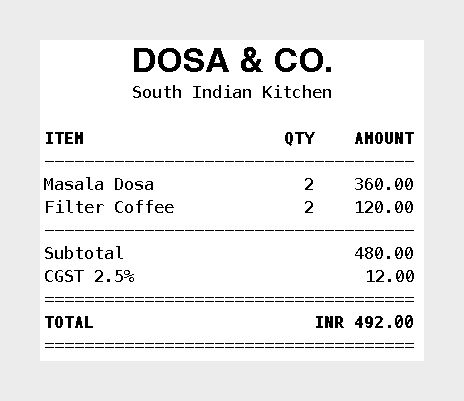

# Dashboard

Served at `/` by `minixprint serve` — plain `index.html` + `app.js` + `style.css` in
`minixprint/server/static/`, no build step, no dependencies, relative URLs only. Open it at
`http://127.0.0.1:8090/` or, on the Pi, `https://swap-pi.<tailnet>.ts.net/print/` (keep the
trailing slash). Try it without a printer: `minixprint serve --fake`.

Designed for a phone (single column, 16 px inputs so iOS doesn't zoom, safe-area insets) and follows
`prefers-color-scheme`.

Top to bottom:

1. **Status bar** (sticky): battery %, paper/cover status, busy/idle, transport (USB/BLE/fake), queue
   depth, and the Tailscale user name. A banner appears in fake mode. Polls every 5 s.
2. **Compose**: tabs Text · Markdown · Receipt (form with item rows, or an "Edit as JSON" toggle) ·
   Image (file picker, dither select, gamma slider, invert) · QR (data + caption). **Preview** shows
   the exact 384-px bitmap on a paper-coloured card; **Print** enqueues it.
3. **Fun**: one button per `/api/jobs` entry with its docstring summary (also its tooltip), a params JSON box and
   Preview/Print.
4. **Schedules**: list with enable checkbox and delete, plus a form (`daily 07:30`, `weekly MON,FRI 18:00`,
   `every 30m`, job, optional params JSON).
5. **History**: horizontal strip of thumbnails of the last 30 jobs (failed jobs in red, hover/long-press
   for details); tap one for the full PNG. Below: **Feed paper** and a **Settings** drawer (home airport,
   airports, timezone, density, `max_height_px`).

## Screenshots

Captured from `minixprint serve --fake` (seeded with a few jobs and schedules).

**Desktop** (the layout is a centred single column):

**Phone** (390 px wide):

**Preview** shows the exact 384-px bitmap that would be printed:

Fun buttons show each job's description as a tooltip (hover, or long-press on touch devices).
