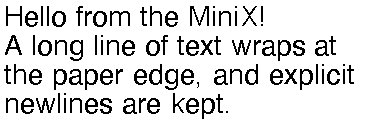
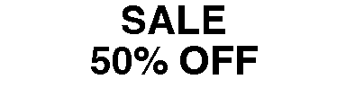
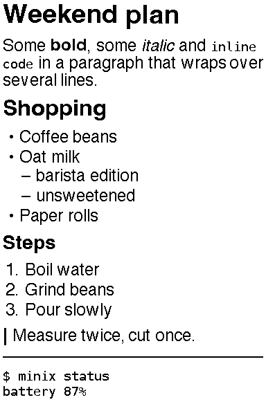
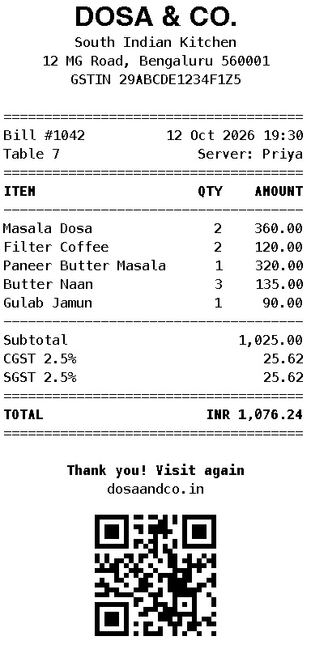
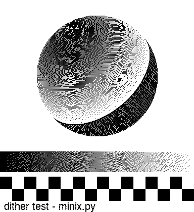
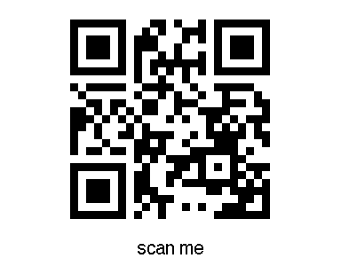
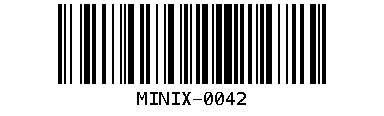
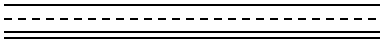

# Rendering layer (`minixprint.render`)

Everything that produces something to print lives here. Every function returns a Pillow
**mode-`"1"` image exactly `WIDTH = 384` px wide**, where pixel value `0` is black (ink) and
`255` is white (paper). Height is whatever the content needs (always ≥ 1).

```python
from minixprint.render import render_text, render_markdown, stack, to_rows
img = stack(render_text("Hi", size=40, bold=True, align="center"), render_markdown("- a\n- b"))
rows = to_rows(img)       # bytes, ready for the printer driver
```

## Design rules

1. **384 px wide, 1-bit.** The print head is 384 dots (48 bytes) at 203 dpi (≈ 48 mm). Every
   renderer outputs exactly that width so blocks compose with `stack()` and need no further
   scaling. Anything wider is wrapped/scaled, never clipped silently.
2. **No grey.** Thermal paper is binary. Text is rasterised with FreeType's monochrome
   hinting (crisp strokes) rather than anti-aliased-then-thresholded; photos go through a
   dither (below).
3. **Fonts resolve portably** (`render/fonts.py`): macOS Helvetica / Menlo → DejaVu Sans /
   DejaVu Sans Mono (Linux, Raspberry Pi: `apt install fonts-dejavu-core`) → Pillow's built-in
   default. A missing bold/italic face degrades to the nearest available one. Set
   `MINIXPRINT_FONT_SANS` / `MINIXPRINT_FONT_MONO` to a `.ttf` path to force a font.
4. **Never crash on content.** Odd Markdown, empty strings and over-long words render
   something sensible (empty input → an 8 px blank strip).
5. **Why Atkinson for photos.** Floyd–Steinberg diffuses 100 % of the quantisation error, so
   large flat grey areas turn into a busy "worm" texture and thermal dots bleed together.
   Atkinson (Macintosh, 1984) diffuses only 6/8 of it: highlights and shadows clip to clean
   paper/black, midtones keep a regular dot pattern, and contrast looks punchier on a
   low-resolution head. Use `"fs"` for smooth gradients, `"none"` for line art / screenshots.
6. **Dependencies:** Pillow, `qrcode`, `python-barcode`, `markdown-it-py` (strict CommonMark,
   tree API, pure Python, installs on a Pi). Python 3.9+.

## API

### `render_text(text, size=28, align="left", bold=False, mono=False, margin=4, line_spacing=1.0)`
Word-wrapped text. `\n` is honoured, words longer than a line are split, leading indentation on
a hard-newline line is kept. `align` is `left|center|right`; `line_spacing` multiplies the font's
natural line height; `margin` pads all four sides.

```python
render_text("Hello from the MiniX!\nA long line wraps at the paper edge.", size=28)
```
 

### `render_markdown(md, size=24)`
Supports `#`/`##`/`###` (larger bold; deeper levels are bold body text), paragraphs, bullet and
numbered lists (nested), `---` rules, `**bold**`, `*italic*`, `` `inline code` ``, fenced and
indented code (mono), blockquotes (left bar). Links show their text, images their alt text,
tables/HTML degrade to plain text.

```python
render_markdown("# Weekend plan\n- Coffee\n  - beans\n\n> Measure twice.\n")
```


### `render_receipt(data)`
Monospace receipt (Menlo/DejaVu Mono 17 px ≈ 36 columns, Helvetica-bold title). Columns are
character cells, so amounts right-align exactly; long item names wrap.

| key | meaning |
| --- | --- |
| `title` | big centred heading; shrinks/wraps to fit |
| `subtitle_lines` | centred lines under the title |
| `meta` | `{"left": "right", ...}` or list of pairs, drawn between `=` rules |
| `items` | `[{"name", "qty" (default 1), "price" (unit price)}]` |
| `taxes` | `{"label", "rate"}` (rate in **percent** of subtotal) or `{"label", "amount"}` |
| `currency` | prefix on the bold TOTAL line |
| `footer_lines` | centred; the first line is bold |
| `qr` | string rendered as a QR code at the end |

```python
render_receipt({"title": "DOSA & CO.", "items": [{"name": "Masala Dosa", "qty": 2, "price": 180}],
                "taxes": [{"label": "CGST", "rate": 2.5}], "currency": "INR",
                "footer_lines": ["Thank you!"], "qr": "https://dosaandco.in"})
```


### `render_image(src, dither="fs", gamma=1.0, invert=False, max_height=None)`
`src` is a path or PIL image (alpha is flattened onto white, EXIF orientation applied). Scaled
to 384 px keeping aspect. `dither`: `"fs"` (Pillow's Floyd–Steinberg), `"atkinson"` (own
implementation, pure Python ≈ 0.2 s for a 384×500 image), `"none"` (threshold at 128).
`gamma > 1` brightens midtones, `< 1` darkens (applied before dithering). `invert` prints a
negative. If `max_height` is smaller than the scaled height the image is scaled *down* to fit
and centred on the paper.

```python
render_image("photo.jpg", dither="atkinson", gamma=1.2)
```
Floyd–Steinberg | Atkinson

 

### `render_qr(data, caption=None, box_size=None, fill=0.7)`
QR (error correction M, 2-module quiet zone) drawn at an integer pixel scale. `box_size` is px
per module; by default the largest size keeping the symbol within `fill` of the width.
Raises `ValueError` if an explicit `box_size` does not fit.

```python
render_qr("https://example.com", caption="scan me")
```


### `render_barcode(data, kind="code128", caption=True, height=80)`
Any `python-barcode` symbology (`code128`, `code39`, `ean13`, `upca`, …), integer module scale
(≤ 4 px) with a 10-module quiet zone, human-readable text below. `ValueError` if it cannot
fit 384 px.



### Composition (`compose.py`)
* `stack(*images, gap=8)` — concatenate 384-px blocks vertically (`None` entries skipped).
* `rule(style="solid"|"dashed"|"double")` — horizontal rule block.
* `pad(img, top=0, bottom=0)` — add white space.
* `to_rows(img) -> bytes` — pack for the printer: 48 bytes/row, MSB first, `1` = black.
  Byte-for-byte identical to `pack()` in `minix.py` (checked in the tests) but uses
  Pillow's native packing, so it is fast enough for long receipts.



## Previewing without a printer

```bash
python3 scripts/preview.py text "hi" out.png --size 40 --align center
python3 scripts/preview.py md "# Title\n- a\n- b" out.png      # or @file.md, or - for stdin
python3 scripts/preview.py receipt --sample out.png            # or a JSON file
python3 scripts/preview.py image photo.jpg out.png --dither atkinson
python3 scripts/preview.py qr "https://example.com" out.png --caption "scan me"
python3 scripts/preview.py barcode 123456789 out.png
```
Add `--scale 2` to enlarge. `python3 scripts/make_samples.py` regenerates `docs/samples/`.

## Tests

```bash
python3 -m venv .venv && .venv/bin/pip install -e '.[dev]' && .venv/bin/pytest
```
